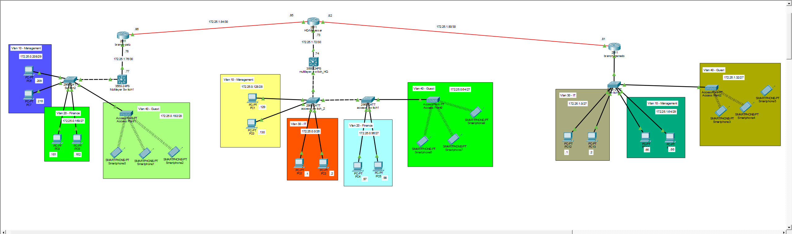

# PT Cahaya Timur — 3-Site VLAN & Static Routing

Studi kasus jaringan enterprise 3 site (hub & spoke) dengan VLSM, VLAN, trunking, multilayer switching, ROAS, static routing, dan wireless guest access — diimplementasikan dan diverifikasi penuh di Cisco Packet Tracer.

## Topologi

- **HQ ↔ Palu** dan **HQ ↔ Manado** terhubung langsung.
- **Palu ↔ Manado tidak ada link langsung** — traffic antar kedua branch ini wajib lewat HQ (hub & spoke), sesuai static route yang dikonfigurasi di ketiga router.

## Perangkat & Metode Inter-VLAN per Site

| Site | Perangkat | Metode Inter-VLAN |
|---|---|---|
| HQ Makassar | R-HQ + Multilayer Switch HQ + 2x Access Switch (SW1, SW2) | SVI di Multilayer Switch |
| Branch Palu | R_branch_palu + Multilayer Switch Palu + Access Switch | SVI di Multilayer Switch |
| Branch Manado | R-Manado + Access Switch | ROAS (sub-interface di router) |

**Native VLAN** pada seluruh trunk port (switch-to-switch maupun switch-to-router) diset ke **VLAN 99**, bukan default VLAN 1.

## Pengalamatan IP

### VLAN per Site

| Site | VLAN | Divisi | Network | Gateway (SVI/ROAS) |
|---|---|---|---|---|
| HQ | 10 | Management | 172.25.0.128/28 | 172.25.0.142 |
| HQ | 20 | Finance | 172.25.0.96/27 | 172.25.0.126 |
| HQ | 30 | IT | 172.25.0.0/26 | 172.25.0.62 |
| HQ | 40 | Guest | 172.25.0.64/27 | 172.25.0.92 |
| Palu | 10 | Management | 172.25.0.208/29 | 172.25.0.214 |
| Palu | 20 | Finance | 172.25.0.160/27 | 172.25.0.174 |
| Palu | 40 | Guest | 172.25.0.192/28 | 172.25.0.206 |
| Manado | 10 | Management | 172.25.1.64/29 | 172.25.1.70 |
| Manado | 30 | IT | 172.25.1.0/27 | 172.25.1.30 |
| Manado | 40 | Guest | 172.25.1.32/27 | 172.25.1.62 |

### Link Point-to-Point (/30)

| Link | Network | IP Masing-masing |
|---|---|---|
| R-HQ ↔ Multilayer Switch HQ | 172.25.1.72/30 | .73 (R-HQ) / .74 (MLS-HQ) |
| R-branch-palu ↔ Multilayer Switch Palu | 172.25.1.76/30 | .78 (Router) / .77 (MLS-Palu) |
| R-HQ ↔ R-Manado | 172.25.1.80/30 | .82 (R-HQ) / .81 (R-Manado) |
| R-HQ ↔ R-branch-palu | 172.25.1.84/30 | .85 (R-HQ) / .86 (R-Palu) |

## Routing

Static route dikonfigurasi di ketiga router agar seluruh VLAN antar-site dapat saling terhubung, dengan Palu ↔ Manado di-route lewat R-HQ sebagai next-hop. Multilayer Switch HQ dan Palu masing-masing hanya punya satu default route menuju router di site-nya (`0.0.0.0/0`), karena semua traffic keluar site itu memang harus lewat router.

**Desain keamanan yang disengaja:** tidak ada static route yang menghubungkan Guest VLAN satu site ke Guest VLAN (atau VLAN lain) di site lain. Guest VLAN di tiap site diisolasi secara routing — perangkat Guest hanya bisa berkomunikasi dalam site-nya sendiri, tidak bisa menyebrang ke site lain.

## Wireless (Guest VLAN)

Setiap site punya Access Point sendiri untuk VLAN 40 - Guest:

| Site | SSID | Authentication | Encryption |
|---|---|---|---|
| HQ | AP-HQ | WPA-PSK | AES |
| Palu | AP-Palu | WPA-PSK | AES |
| Manado | AP-Manado | WPA-PSK | AES |

## Verifikasi

Ping yang sudah diuji dan berhasil (0% loss):

- PC Management VLAN 10 Palu → PC IT VLAN 30 Manado (`172.25.1.1`) — lintas site via HQ
- PC Management VLAN 10 Palu → PC Finance VLAN 20 Palu (`172.25.0.162`) — antar-VLAN satu site
- PC Management VLAN 10 Palu → PC IT VLAN 30 HQ (`172.25.0.1`) — lintas site langsung

Hasil ini mengonfirmasi inter-VLAN routing (SVI & ROAS), static routing antar-site, dan hub & spoke routing (Palu → Manado lewat HQ) semuanya berfungsi dengan benar.
